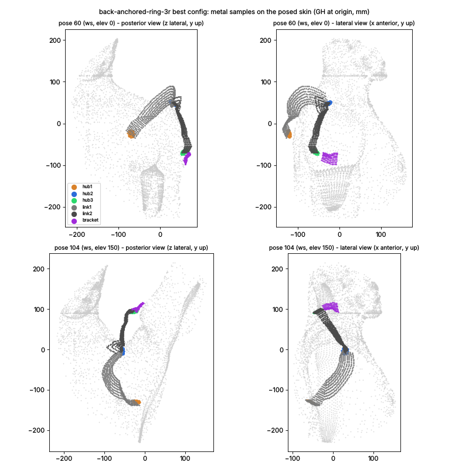

# Back-anchored ring-ended 3R (back-anchored-ring-3r)

## Deeper-version prompt (answered before modelling)

1. **What a top mechanism designer would do that the spec does not ask for.** Treat the two rings as *what they
   cost on curved skin*, not only what they save in stack: an O45-65 flat annulus is 3x the O20 footprint, so on a
   curved back or arm it must stand higher to clear its highest point. Test ring vs O20 hub at each end (the spec only
   offers rings), size the ring to the flattest skin patch the ray actually meets, and connect the arm ring to the
   user's BOTTOM bar honestly (a bracket when the ring sits posterior of the lateral saddle). Then attack the limiter
   the sibling posterior 3R measured (links 26-30 mm off the skin): shorter arcs (a12, a23 < 90) and a J3 placed so
   link 2 lies along the arm, not across the moving posterior deltoid.
2. **Rawest material.** The posed skin itself (signed distance per bench pose through the fast grid cache /
   `Bench.dist`), the six fit clips walked frame by frame and interpolated by the kit's dense continuity, and
   `pipeline/conformal/analysis/skin_motion_map_14.json` (per-direction radial skin motion in the scapula and humerus
   frames) to choose where the J1 ray and the J3 ray pierce still skin - not the catalogue's summary numbers.
3. **Methods and tools.** `tools/concept_kit.py` (K1 two-cone closure, K3 per-sample skin march, K4 flat O20 hub,
   K5 straps with the 60 deg climb, K6 part-part collisions, K2 dense continuity along the clips, audit), flat
   annulus members for the thin-section rings (fitted along their own axis like K4), numpy-vectorised sweeps coarse
   then refined on Bench(60, 160).
4. **What other than me shows the number is right.** The bench (`concept_bench`, the same scoring as the 68.93
   baseline row), the kit's honesty audit (`honest` flag), the in-model control (O20 hubs in place of the rings,
   same chain), the adversarial verifier on the exact path / full bench, and a red-team pose list (overhead elev >=
   150, behind-the-back, across-the-body with internal rotation, back pocket) with the part that pinches per pose.

## Model (docs/concepts/models/back-anchored-ring-3r.py, on tools/concept_kit.py)

Spherical 3R, every axis through GH, 3 ACTIVE / 0 PASSIVE (J2 by the closed-form two-cone closure on branch `br`):
scapula handler -> **J1 ring** (S-fixed axis u1 = S-local (lat1, lon1), housed 4.76-section thin ring, pitch p1, as a
flat annulus 9 mm wide, 8 mm stack, open centre, fitted along its own axis like a K4 hub) -> **link 1** (14 x 5.5 Ti
strap on the u-v great circle, K3 skin-fitted underside, 60 deg climb; leaves the ring from a lug 4.5 mm outside the
outer race at the rotating housing level F + 4.8) -> **J2 O20 v5 hub** (K4, link 1 lower member at F, link 2 upper
at F + 3.15) -> **link 2** (same strap, passes >= 1 mm over link 1) -> **J3 ring** (humerus-fixed axis at angle d3
from the humerus axis, azimuth th3 posterior of lateral, rig arm frame) -> **bracket** (14 x 6 strap from the ring's
stator lug to BOTTOM's bar, only when the ring centre is > 18 deg off the bar) -> BOTTOM. p = 0 turns a ring into an
O20 hub (the in-model control). Checks: K3 march, K2 dense continuity along the six fit clips (joint values and axes),
K6 collisions, kit audit, serial singular margin >= 5 deg and fold / stretch margin >= 10 deg.

### Where the spec was wrong (and what the model does instead)

* **The arm ring cannot sit on the arm where the spec puts it.** j3 through the arm point (s 100-160, rho 60) is only
  21-31 deg from the humerus axis, so an axis through GH meets the arm skin ~60-70 deg off its normal: the flat ring
  stands on edge. Measured at the spec's nominal (s 120 / th 40, d3 = 26.6): ring 3's annulus needs a median 138 mm
  from GH (skin ~134 on its axis) and > 189 mm in the worst 5 % of poses. The model parametrises J3 by d3 (angle from
  the humerus axis) so the sweep can move the ring up to where the arm skin is radial to GH (d3 -> 90).
* **The spec's "no neck" needs a bracket.** BOTTOM's bar runs down the LATERAL arm; a ring posterior of lateral (th3 >
  ~18 deg off the bar) needs a stator bracket to it, which the model includes at real size.
* Link roots on the rings: the kit exempts joint partners from K6 only within 12 mm of the joint axis (O20 size), so
  a strap root lying on a 28 mm-radius ring race would be a false collision. The strap starts at a 4.5 mm lug outside
  the outer race (14 x 4.5 mm of lug per joint is the only unsampled metal, < 1 % of the samples).

## Rawest-material checks that drove the sweep

**Obliquity of the ray from GH at the skin** (angle between the J-axis ray and the outward skin normal / skin radius
mm, S-local lat / lon, median over 6 low-elevation bench poses; a flat seat of radius a on that skin rises about
a tan(obliquity) on one side; scratch script, numbers below are measured):

| lat \ lon | -150 | -135 | -120 | -105 | -90 | -75 | -60 | -45 | -30 |
|---|---|---|---|---|---|---|---|---|---|
| -20 | - | 43/171 | 55/129 | 39/102 | 35/92 | 41/85 | 36/81 | 35/77 | 33/76 |
| -10 | 45/195 | 43/161 | **52/117** | 37/94 | 37/83 | 33/76 | 31/72 | 30/70 | 26/69 |
| 0 | 39/187 | 50/150 | 50/107 | 39/86 | 33/75 | 32/69 | 26/65 | 22/64 | 20/64 |
| 20 | 53/168 | 49/131 | 51/96 | 37/76 | 29/65 | 19/60 | 13/58 | 15/58 | 18/58 |
| 30 | 53/148 | 55/118 | 53/89 | 41/72 | 29/63 | 17/58 | 13/56 | 16/56 | 16/55 |
| 40 | 62/123 | 55/102 | 55/80 | 38/68 | 32/60 | 22/55 | 18/54 | 17/53 | 16/52 |
| 50 | 62/89 | 60/80 | 48/69 | 38/62 | 30/57 | 22/53 | 12/51 | 14/50 | 17/50 |

**Skin motion** (`pipeline/conformal/analysis/skin_motion_map_14.json`, scapula frame, mm of radial motion over the
fit clips): spec J1 (lat -10, lon -120) 13 mm; lat 35-45 / lon -75..-100 2-4 mm; lat 20 / lon -75 13 mm.

So the spec's J1 site is the worst of both: the ray grazes the infraspinous fossa at ~52 deg (a 29 mm ring rises
~37 mm across) and the skin there moves 13 mm. The posterosuperior shoulder over the scapular spine (lat 35-45,
lon -75..-100) is still behind the acromion, meets the ray at 17-38 deg and moves 2-4 mm: that is where the
variant moves J1.

## Sweep (Bench(60, 160), fast grid cache, K3 `march`, K2 dense, K6 on; every configuration in order in
`docs/concepts/sweeps/back-anchored-ring-3r.json`)

Stage j3 (spec J1 at lat -10 / lon -120, rings p1 = p3 = 24.6 (KAA17), a12 = a23 = 90, q 0.97; J3 at d3 from the
humerus axis, th3 posterior of lateral):

| k | d3 | th3 | gap | reach | follow | in-band 14 | contact |
|---|---|---|---|---|---|---|---|
| 0 | 26.6 (spec s 120) | 0 | 93.40 | 0.938 | 0.983 | 0.016 | 0.050 |
| 1 | 26.6 | 30 | 154.96 | 0.869 | 0.500 | 0.063 | 0.232 |
| 2 | 26.6 | 60 | 92.69 | 0.875 | 1.000 | 0.089 | 0.091 |
| 3 | 50 | 0 | 88.08 | 0.900 | 1.000 | 0.079 | 0.060 |
| 4 | 50 | 30 | 86.84 | 0.931 | 1.000 | 0.073 | 0.041 |
| 5 | 50 | 60 | 97.35 | 0.888 | 1.000 | 0.012 | 0.073 |
| 6 | 70 | 0 | 102.42 | 0.813 | 0.950 | 0.085 | 0.122 |
| 7 | 70 | 30 | 98.13 | 0.850 | 1.000 | 0.074 | 0.105 |

(stage cut after k7 for CPU: the box ran at load 20-24 on 4 cores, ~1.5-2 min per configuration.) None of these is
`honest` in the kit audit: parts sit at the 400 mm "never clears" cap, so their samples are sparser than 4 mm.
Measured limiter at k4 (members' fitted levels, scratch diagnostic): ring 1 raw per-sample level median 129 mm, flat
level 173 mm (the skin on its axis is at ~117 mm: the 52 deg graze); hub 2: 4 % of its samples never clear in > 3 % of
poses -> 400 mm; link 1: 8 % of samples -> 400 mm. J2 (branch +1; branch -1 puts it inside the trunk) runs on the
great circle 90 deg from the back-pointing u1, from S lat +50 to -23 at lon -26..-42: overhead it dips under the
raised arm (S lat -23 in one of the five highest poses) - the likely source of hub 2's never-clearing rays.

**The tension inside the morphology (measured, scratch diagnostics on k4 / k8).** Moving J1 up to its good seat
(lat 35 / lon -100) drops ring 1 from a flat level of 173 mm to 95 mm (raw per-sample median 129 -> 70), but the
closure then sends J2 over the top: with a12 = 90 the circle 90 deg from a posterosuperior u1 runs over the acromion
to the front, and overhead J2 sits at S lon +68..+158 (anterior / medial, toward the neck): every hub-2 sample and half
of each link never clears the body within 220 mm in > 3 % of poses (hub 2 and links at the 400 mm cap). With a12 = 72
J2 stays lateral (lon -37..+38) but the chain closes in only 81 % of poses. With J1 low on the back (the spec), J2
stays posterolateral (lon -26..-42) but J1 grazes the fossa. A spherical chain whose J1 points backward has no seat
that is both square to the skin and keeps J2 behind the shoulder overhead.

## Honesty checklist (what the numbers include)

* Every part between the scapula handler and BOTTOM at real size: two housed 4.76-section rings (9 mm wide, 8 mm
  stack, flat annuli fitted along their axes) or O20 v5 hubs (K4, 12.25 stack), the J2 O20 hub, two 14 x 5.5 Ti
  straps, the 14 x 6 J3 bracket to BOTTOM's bar when the ring sits off the bar. Unsampled: the three 4.5 x 14 mm
  lugs between ring races and strap roots (< 1 % of the metal area).
* Skin-facing undersides sampled on the kit's 2 mm grids (flat parts in true mm, straps at r_ref 70 like the
  baseline). A part at the 400 mm "never clears" cap makes the kit audit flag sparse sampling; those configurations
  are reported with `honest: false` in the sweep file and are bad anyway.
* Closure: closed form (residual 0.0 deg), fold / stretch margin >= 10 deg and serial margin >= 5 deg in `ok`.
  Branch +1 (branch -1 puts J2 inside the trunk). K2 dense continuity on joint values and axes along the six fit
  clips; K6 collisions on (link 2 built >= 1 mm over link 1). Held-out clips never loaded.
* 3 ACTIVE DOF, 0 passive: nothing is left undetermined.

Stages after j3 (each starts from the best configuration so far, or states every parameter; q = underside quantile):

| k | change | gap | reach | follow | in-band 14 | contact | closure | Ti g | honest |
|---|---|---|---|---|---|---|---|---|---|
| 8 | J1 lat 35 / lon -100 (rings, a12 90, q .97) | 110.18 | 0.794 | 0.867 | 0.123 | 0.135 | 0.95 | 2095 | no |
| 9 | J1 lat 35 / lon -75 | 97.60 | 0.831 | 0.933 | 0.138 | 0.129 | 0.99 | 2076 | no |
| 10 | J1 lat 45 / lon -100 | 119.85 | 0.775 | 0.850 | 0.097 | 0.171 | 0.97 | 2228 | no |
| 11 | J1 lat 45 / lon -75 | 96.70 | 0.844 | 0.917 | 0.159 | 0.136 | 1.00 | 2146 | no |
| 12 | spec J1, d3 50 / th3 30, **O20 hubs at both ends** | 82.26 | 0.938 | 1.000 | 0.114 | 0.037 | 0.99 | 2129 | no |
| 13 | hub at J1, ring at J3 | 85.78 | 0.925 | 1.000 | 0.084 | 0.042 | 0.99 | 1977 | no |
| 14 | ring at J1, hub at J3 | 83.80 | 0.938 | 1.000 | 0.099 | 0.037 | 0.99 | 2049 | no |
| 15 | k12 with a12 72 / a23 75 | 113.73 | 0.688 | 0.900 | 0.139 | 0.114 | 0.85 | 328 | no |
| 16 | k12 with a12 72 / a23 90 | 101.15 | 0.769 | 1.000 | 0.136 | 0.116 | 0.96 | 347 | no |
| 17 | k12 with d3 88 (J3 at GH level) | 100.29 | 0.781 | 1.000 | 0.151 | 0.136 | 0.97 | 2549 | no |
| 18 | k12 at q 0.92 | 116.31 | 0.644 | 0.767 | **0.362** | 0.186 | 0.99 | 252 | **yes** |
| 19 | combo: J1 lat 35 / lon -75, hubs, a12 66, q .92 | 144.93 | 0.444 | 0.583 | **0.426** | 0.152 | 0.83 | 164 | yes |
| 20 | combo: same, a12 75 | 155.27 | 0.425 | 0.517 | 0.417 | 0.161 | 0.91 | 173 | yes |
| 21 | combo: J1 lat 45, hubs, a12 66 | 158.82 | 0.413 | 0.483 | 0.418 | 0.152 | 0.83 | 170 | yes |
| 22 | combo: J1 lat 45, hubs, a12 75 | 112.69 | 0.719 | 0.867 | 0.194 | 0.157 | 0.90 | 1979 | no |
| 23 | combo: J1 lat 45, rings, a12 66 | 275.00 | 0 | 0 | 0 | 0 | 0.83 | 199 | yes |
| 24 | combo: J1 lat 45, rings, a12 75 | 111.85 | 0.725 | 0.867 | 0.191 | 0.152 | 0.90 | 1737 | no |
| 25 | k12 at q 0.95 | 114.56 | 0.744 | 0.767 | 0.192 | 0.098 | 0.99 | 321 | no |

"honest: no" = the kit audit flags parts sitting at the 400 mm never-clears cap (hub 2 / link 1 / link 2 float there:
Ti mass 1.7-2.5 kg). Such a configuration is NOT a design: a part parked 400 mm from GH never touches the skin, so it
buys reach and low contact for nothing. Its gap (k12: 82.26) must not be quoted as this morphology's number.
| 26 | J1 lat 35 / lon -75, hubs, a12 90, q .92 | 112.06 | 0.738 | 0.917 | 0.178 | 0.203 | 0.99 | 2099 | no |
| 27 | same, a12 85 / a23 105 | 126.48 | 0.669 | 0.867 | 0.174 | 0.224 | 0.93 | 2179 | no |
| 28 | J1 lat 20 / lon -90, hubs, a12 90, q .95 | 95.16 | 0.819 | 0.967 | 0.142 | 0.113 | 0.97 | 2083 | no |

29 configurations in all (Bench(60, 160); the CPU box ran at load 19-24 on 4 cores, 45-90 s each).

## Result

**Best honest configuration: k18** - J1 at the spec's site (S lat -10 / lon -120) but as an **O20 hub** (the rings
lose: k12-k14), J3 hub at d3 50 / th3 30 (posterolateral deltoid, not the spec's arm site), a12 = a23 = 90, branch
+1, q 0.92: **gap 116.31** (reach 0.644, follow 0.767, in-band 14 0.362, in-band 10 0.161, contact 0.186; Ti 252 g;
singular margin 14.4 deg worst, 32.8 deg at the 5th percentile; 0 flips; kit audit clean). The lowest gap in the sweep
(k12, 82.26) is not a design: hub 2 and the links sit at the 400 mm cap. Champion 3R: 68.93.

Per member at k18 (clip frames taken, kit `inband_member`): bracket 0.92, hub 3 0.58, link 2 0.52, hub 2 0.42, hub 1
0.27, **link 1 0.05** (median 31.7 mm off the skin).

## Red team of k18 (scratch script; every number measured on Bench(60, 160))

* **Overhead (elev >= 140): 17 bench poses, 0 taken clean.** This was meant to be the overhead-first design. From
  elev 90 up, link 1 and hub 2 go into the body (link 1 >= 31.8 mm inside, the grid clamp; hub 2 up to 23 mm, link 2
  up to 23 mm) at plane -15..60 deg. K6 also rejects 35 poses (16 % of the closing poses: two parts closer than the
  clearance), e.g. the clip frames at plane 30 / elev 125-150 / axial -55..-60.
* **Behind the back: 23 poses, 17 taken clean.** As the spec feared, link 2 is squeezed between arm and back: 12 mm
  inside at plane -75 / elev 30 / axial 165, 10.8 mm (with hub 3 and the bracket) at plane -90 / elev 60 / axial 135.
  Squeeze flag (skin < 4 mm below AND body 4 mm above the part's top): link 1 7.1 %, link 2 6.6 %, hub 2 6.0 % of
  the taken poses.
* **Across the body: 50 poses, 37 taken clean.**
* Chain does not close in 2 poses (plane 45 / elev 75 / axial 45; plane 75 / elev 90 / axial 15). 0 branch flips.

## Measured limiter

1. **Link 1 floats (5 % in band, median 31.7 mm off the skin), and overhead it goes into the body.** It is a
   90 deg rigid arc from the back to J2. J2 runs on the circle 90 deg from u1 between S lat +50 and -23, so link 1
   sweeps across the whole posterior shoulder and must clear the highest skin it ever crosses. At rest (sketch) it
   arches up to 90 mm above GH, across the top of the shoulder the design meant to leave bare. Lowering q to bring it
   down turns the overhead poses into contact (q .97 -> .95 -> .92: follow 1.0 -> 0.77 -> 0.77, reach 0.94 -> 0.74 ->
   0.64).
2. **The J1 seat.** On the spec's infraspinous site the ray from GH meets the skin at ~52 deg and the skin moves
   13 mm. A flat ring there stands 173 mm from GH over skin at ~117 mm, so it is never in band. On the square,
   still seat (lat 35-45 / lon -75..-100: 17-38 deg, 2-4 mm motion) J2 swings over the top to the front overhead.
3. **Rings lose to O20 hubs at both ends** (k12 vs k4: 82.26 vs 86.84; in-band 0.114 vs 0.073). A 58 mm flat
   annulus on skin that is curved and oblique to GH rays has to stand higher than a 20 mm disc. The arm ring at the
   spec's site (d3 21-31 deg) stands on edge, ~63 deg to the arm skin.

## Verdict

**Dead as specified, and the variants do not rescue it.** Best honest gap 116.31 (k18), against 68.93 for the
champion. In the combo variant (J1 on its square, still seat + hubs + shorter link 1), the parts reach the champion's
in-band (0.43, k19), but J2 swings over the top and the chain loses reach and follow (0.44 / 0.58). The idea that
survives as knowledge is the J1 seat map, not this chain. Not worth a GPU sweep.
