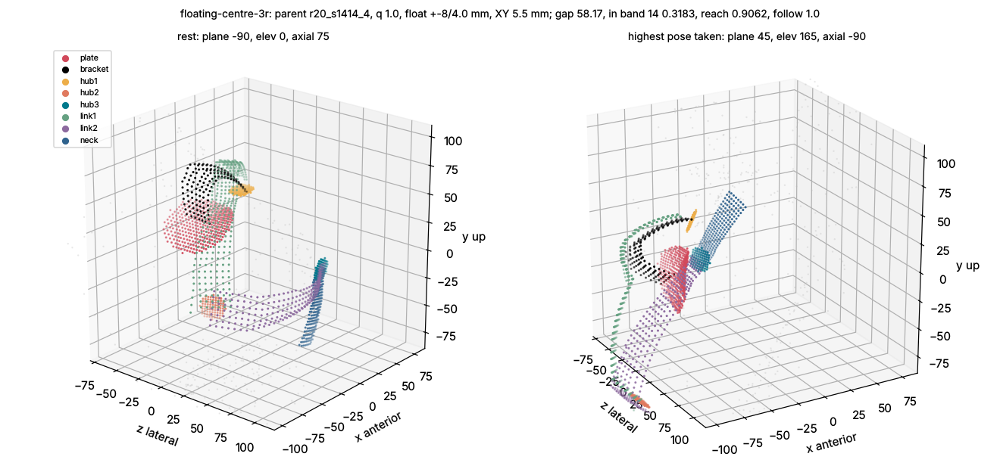

# Floating-centre 3R (floating-centre-3r)

## Deeper-version prompt (answered before modelling)

1. **What a top mechanism designer would do that the spec does not ask for.** Treat the float as what it really is:
   a 3-P stage whose coordinates are *outputs* of the closure (c = GH), so it can never improve the plain-bench
   geometry (the rig has GH fixed in the scapula frame: the float sits at 0 and only adds metal). The designer would
   (a) measure the float's cost honestly on the plain bench (plate + XY stage + normal slide at real size under J1,
   link 1 forced over the stage, K6 on the stage volume), (b) measure its benefit only where it exists - under the
   handler-slip law - comparing it with the parent's cuff slides on the SAME chain, and (c) ask which side of the
   slip carries the in-band metal: if most in-band metal rides the arm skin (the arm-end hub zone), the float is the
   right place for the slide; if it rides the scapula skin, the cuff is. (d) Size the travel from the slip law's
   tangent / normal split along J1's axis instead of a round 12 / 4 mm.
2. **Rawest material.** The posed skin of every bench pose (B.skin / the signed-distance grid), the fit clips in time
   order (B.clip_order, dense slerp between frames for continuity), the slip law's per-axis error angles and the
   Seth-2016 lever (judge/base_slip.py, literature numbers, not a fit), and the arm-skin vertex set BP.ARMV to say
   which skin each metal sample rides. Not the digested in-band summaries of the champion.
3. **Methods and tools.** tools/concept_kit.py (K1 closure, K3 march, K4 flat O20 hubs, K5 straps, K6 collisions,
   K2 dense continuity, audit), the champion chain decoded with the kit's bvec / wdir, a kit-style evaluator that
   adds the per-pose slip offsets to the samples before the K3 fit (ray origins shifted, so undersides are fitted to
   the skin they actually meet), scipy cKDTree for the skin class.
4. **What, other than me, shows the number is right.** The bench's own report (gap_of), the kit audit (`honest`),
   the parent reproduced on the same code (template numbers 69.29 at q 0.95), the adversarial verifier, and a
   red-team pose list (rest, highest overhead, most across-body, mid behind-back, and the pose of largest slip)
   with per-member minimum gaps.

## What was built (docs/concepts/models/floating-centre-3r.py, on tools/concept_kit.py)

The champion chain (r20 s1414 #4: J1 az 2.4 / el 80.7, a = 76.9 / 66.7, W 86.3 / 21.8, branch -1) with kit parts at
real size (flat O20 hubs with the 12.25 stack, 12 x 3 straps with the 60 deg climb, the 14 x 6 K7 neck, link 2 over
link 1 and the neck) plus the float: a skin-contoured PLATE (disc of lateral radius 14 + travel, 2 mm grid in true
mm), a flat slide face (least-squares plane of the underside, or normal to J1's axis) at its top + 1.5, a 5.5 mm XY
stage and n_down of normal travel; the plate's K6 slab is the whole stack above its lowest point (conservative). The
float's 3 slides are the closure's c = GH (no free coordinate); on the plain bench (GH fixed in the scapula frame) they
sit at 0. Links that the float pushes out are re-laid at their true radius (otherwise the kit's 70 mm layout thins to
5-10 mm spacing and the audit fails). All numbers: Bench(60, 160), fast grid cache, K3 march, K2 dense, K6 on,
audit clean (`honest`), unless stated.

**Spec corrections (measured).** (1) The spec's "J1 raised by about 5 mm" is wrong: a flat slide face under J1 must
clear the skin under its whole footprint, and the skin around J1 (acromion -> trapezius ridge) is tilted 17-42 deg to
the plane normal to J1's axis (least-squares plane of the plate underside, measured per configuration); with +-12 mm travel the plate top sits at 66 mm along its normal and hub 1's skin face at 112 mm
(parent: 54 mm). (2) The travel the slip law needs is +-20 mm tangent and 6-9 mm normal (central and high laws, every
parent), not +-12 / 4: +-12 leaves 19 % of the bench poses outside the travel. (3) The spec's "the cuff becomes
simple" holds, but the cuff slides of the parent are not modelled in (a), so (a) is slightly flattered.

## Results (41 configurations, docs/concepts/sweeps/floating-centre-3r.json)

| configuration | gap | reach | follow | in-band 14 | in-band 10 | contact | chain-only in-band 14 |
|---|---|---|---|---|---|---|---|
| parent alone, q 1.0 (= _template) | 65.05 | 0.906 | 1.000 | 0.250 | 0.158 | 0 | 0.250 |
| parent alone, q 0.95 | 69.29 | 0.763 | 1.000 | 0.457 | 0.298 | 0.112 | 0.457 |
| float UNDER J1, +-4 mm, fitted face (20.6 deg tilt), q 1.0 | 63.12 | 0.906 | 1.000 | 0.269 | 0.224 | 0 | 0.095 (hub 1 at 67.2 mm, +13) |
| float under J1, +-8 / +-12 mm | 168-235 | 0.17-0.41 | 0.03-0.45 | | | | hub 1 at 112 mm (+-12, q 0.95) |
| float under J1, +-20 / 8 mm | 89.6 * | 0.825 | 0.917 | 0.158 | 0.140 | 0.046 | 0.048; plate top 354 mm (a footprint ray never clears) |
| **float BESIDE J1 (stage at az 0 / el 35 on the scapula, bracket to J1), +-8 / 4 mm, q 1.0** | **58.17** | 0.906 | 1.000 | 0.318 | 0.227 | 0 | **0.161** |
| same, +-4 mm | 59.73 | 0.875 | 1.000 | 0.328 | 0.229 | 0 | |
| same, q 0.95 | 62.93 | 0.806 | 1.000 | 0.438 | 0.338 | 0.074 | |
| stage at az -45 / el 40 or az 45 / el 35 | 180.7-275 | | | | | | collides with hub 1 / bracket |
| SLIP central: parent + cuff slides (a) | 71.03 | 0.906 | 1.000 | 0.190 | 0.134 | 0 | |
| SLIP central: float beside +-8 / 4 (b) | 102.38 | 0.656 | 0.717 | 0.353 | 0.247 | 0 | travel-limited |
| SLIP central: float beside +-15 / 6 (b) | 73.46 | 0.813 | 0.833 | 0.370 | 0.272 | 0 | |
| SLIP central: float beside +-20 / 8 (b) | 136.53 | 0.406 | 0.567 | 0.412 | 0.298 | 0 | plate under link 1 |
| SLIP high: parent + cuff slides (a) | 70.42 | 0.906 | 1.000 | 0.196 | 0.136 | 0 | |
| SLIP high: float beside (b), best | 136.74 | 0.388 | 0.633 | 0.362 | 0.280 | 0 | |

\* entries k 8-9 were written before the 200 mm cap on the link re-layout; re-run with the current code k 8 reads 77.31 and is NOT honest (links > 200 mm, sparse) - dead either way.

Parents other than r20 s1414 #4 / #0 at q 1.0: hub 2's K4 fit is infinite (J2's axis passes through the body in some
pose, 36 rays never clear in 220 mm), with or without the float; the float runs on them take nothing (gap 275).

**The measured limiter.** On the plain bench the float only adds metal. Its best bench gap (58.17, below the parent's
65.05) is an artefact of the share metric: the skin-contoured plate (0.83 in band, ~380 samples at +-8 mm) lifts the in-band
share while the chain itself moves away - link 1 has to pass over the stage (+ normal travel + 1 mm) and drops from
0.25 to 0.0 in band; chain-only in-band 14 falls from 0.250 to 0.161 (plate-excluded gap 73.95). Under J1 the float
cannot work at all with real travel (flat face on a 17-42 deg skin ridge -> hub 1 +13 mm at +-4, +58 mm at +-12; chain-only in-band 0.095 at +-4). Under the slip law the
float's thesis holds in direction (chain samples over scapula skin get -delta, the arm-end metal stays aligned: in-band
0.35-0.41 vs the cuff-slide parent's 0.19-0.20) but every travel that covers the law (+-15..20 mm) needs a 58-68 mm
plate whose displaced slab runs under link 1 and the bracket: reach falls to 0.39-0.81 and follow to 0.52-0.83.

**Red team (best, k 28).** Rest (plane -90, elev 0): plate 2.1 / 7.8 mm (min / median), hub 1 3.1 / 7.1, bracket
8.3 / 28.7, link 1 17.1 / >31.8, hub 3 12.4 / 14.8, neck 5.9 / 11.5. Overhead (plane 45, elev 165, the highest taken):
plate 2.4, hub 1 2.8, neck 2.7 min; link 1 12.1 / >31.8, hub 2 >31.7. Across (plane 150): hub 3 16.1 / 17.5, neck
12.4 / 18.3. Jams: the 15 poses lost are the parent's own closure folds (plane -90..-60 at elev 30-60 behind the back,
and elev 135 at plane 0-15); no collision and no flip left. Pinch: the plate at 2.0 mm (plane -63, elev 36, axial 75).
The rest pose and the most-behind pose coincide on this bench (plane -90, elev 0).

**Verdict.** Not worth a GPU sweep as a morphology: on the plain bench it is the parent plus a skin-hugging plate (the
gap gain is the plate's samples, the chain is worse), and on the slip bench the travel that the slip law needs makes
the float plate too big for the space under link 1. As a topology modifier the idea that survives is narrower: a
SMALL float (+-4..8 mm) beside J1 removes the low-elevation part of R10 at almost no cost (58-60 on the plain bench,
chain-only 0.16) but needs the cuff slides anyway overhead, so it does not simplify the cuff.

## Verification (adversarial verifier, 2026-10-15)

Verdict: **refuted**. The corrected gap on Bench(110, 360), exact path, is **136.31** (baseline 68.93; claimed 58.17).
The best configuration (sweep k 28: parent r20 s1414 #4, q 1.0, stage beside J1 at az 0 / el 35, +-8 / 4 mm) was
refitted on each bench by the model's own `evaluate` (plate constants, re-layout loop, kit K3 march, K2 dense, K6).

| check | result |
|---|---|
| 3 ACTIVE DOF, no undetermined passive coordinate | holds: the arm member is rigid on the cuff, so the chain centre is a fixed point of the humerus frame and the float's 3 translations are set by c = GH (3P + 3R = 6 against the cuff's 6). On the plain bench the float is at 0. |
| closure residual | 0.0 deg (closed form); J2 fold margin >= 10.1 deg |
| branch continuity (K2 dense) | 0 flips on both benches |
| part-part clearance | K6 re-run with 1 mm RADIAL clearance (the kit enforces 0.5): no extra pose lost at 0.99 mm. At exactly 1.00 mm, 83 poses fail on float round-off, because `over` builds exactly 1 mm. |
| **missing part height: the bracket's stage end** | The bracket (J1's lower member) leaves the XY stage at JF. JF is hubless, and `over` exempts the shared-joint zone, so the bracket's first ~12 mm sat at skin level, inside the plate's 24 mm slab. Fix: that end ramps to the plate + slab + normal travel + 1 mm. Gap 58.17 -> **58.62** (Bench(60,160), fast); bracket in band 0.090 -> 0.045. |
| plate in-band artefact | Confirmed as the author reported. The chain-only gap (plate samples excluded, same poses) is 74.54 on Bench(60,160), against 58.62 with the plate. |
| grid-cache artefact (CB_EXACT=1 on Bench(60,160)) | **not completed**: the exact path took > 10 min per configuration at load ~12, and the run was stopped by its time limit. The large-bench run below is on the exact path anyway. |
| **re-measure, Bench(110, 360), exact, with the fixes** | **gap 136.31**: reach 0.500, follow 0.718, in-band 14 0.1725, in-band 10 0.1292, contact 0.0038; chain-only gap 147.57 |

On the larger bench the chain falls apart in the parent's own weak member, not in the float. Hub 2 and link 2 go out
of band: the re-layout loop moves link 1 to 120 mm and link 2 to the 200 mm cap. K6 then loses 39 % of the closing
poses to collisions (collide 0.387), the neck re-lays at 10.8 mm spacing, and the audit flags it (`honest` false).
Per-member in-band 14: plate 0.77, hub 1 1.00, link 1 0.06, bracket 0.03, and 0 for hub 2, hub 3, link 2 and the neck.
This is the "infinite K4 fit for hub 2 at q 1.0" the author found on four other parents. With 470 poses, it now hits
r20 s1414 #4 too: some new pose puts J2's axis through the body. The plate is the only member that stays in band.

Holes that remain:
* The parent alone (float = 0) was not re-run on Bench(110, 360). That run costs ~80 min on the exact path. It most
  likely collapses the same way, since the failure is in hub 2 / link 2, so the large-bench number condemns the q 1.0
  spherical chain as much as the float. The baseline's 68.93 is itself a Bench(60, 160) number.
* The normal slide (+-4 mm along the slide-face normal) has no guide hardware in the model. Only its travel is
  reserved, as the 5 mm gap under the bracket.
* The kit's `over` builds exactly 1 mm. A K6 at a literal ">= 1 mm" fails on round-off: use 0.99 or build 1.05.
* Speed: the exact path's 24-pose skin cache thrashes when the K3 march sweeps all poses. Keeping every posed skin cut
  this run from > 30 min stalled to 81 min, so a 470-pose fast cache is what large-bench verification needs.

Scripts: the verifier's scratchpad `vfc/verify.py` (monkey-patches only the verifier's copy of the model: the bracket
ramp, the skin cache).
