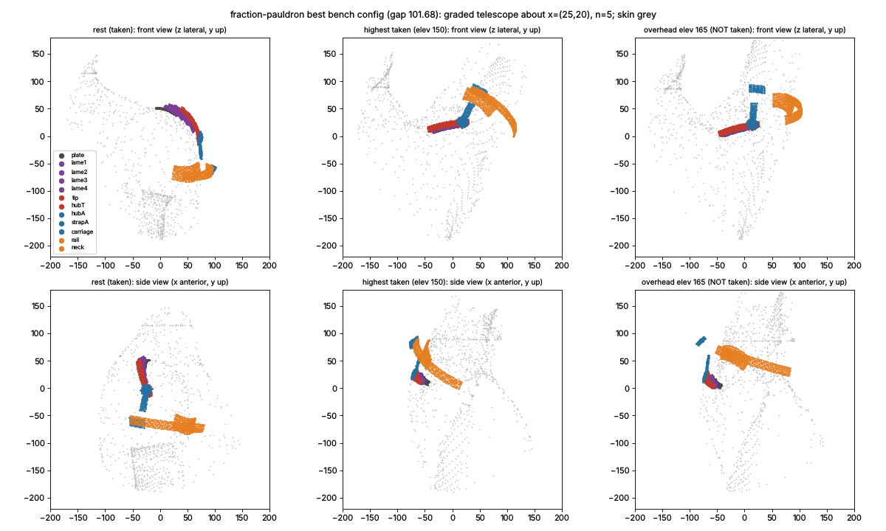

# Fraction pauldron (graded telescoping lames on a gimbal, twist at the cuff)

Lens: the proximity atlas (docs/research/proximity_atlas.md). Model: `docs/concepts/models/fraction-pauldron.py`
(shared kit, tools/concept_kit.py). Sweep: `docs/concepts/sweeps/fraction-pauldron.json` (203 entries; only
`rev: 3` is reported).

Two measurement corrections were made on my own model during the sweep; they are reported separately from the
design changes:

- **rev 1 -> 2.** The cuff rail's underside had been free-shaped per sample. A circular track cannot be; it is now
  one radius along its length. The best gap went from 117.7 to 125.1 on the same parameters.
- **rev 2 -> 3.** A face whose skin requirement had no clearance within 220 mm in more than 1-q of the poses was left
  floating at 400 mm from GH. That happened to the cuff rail, which was drawn 400 mm out, so rev 2's best gap of
  92.3 is not a real design. Every face is now capped at RMAX = 130 mm, and the poses that would need more count as
  contact.

## Deeper-version prompt (answered before modelling)

1. **What a top kinematician would do that the brief does not ask for.** Type synthesis before any sweep. For each
   candidate from the other fields (armour lames, lazy tongs, scissor arcs, rolling-contact spines, CV couplings,
   nested shells), write down the coupling law it actually realises: each member's frame as a function of the arm
   pose. Then ask whether that law is holonomic and determined: no drift over a clip, no sag. Score the law against
   the measured target field with the atlas, and count the stroke each coupling has to store. A telescope stores its
   stroke as length; a hub stack stores it as rotation. Check the singularities (gimbal lock) over the workspace.
   Only then build the best realisation at real size.
2. **Rawest material.** The posed skin of every bench pose (the atlas's per-pose skin heights, and B.dist on the
   posed skin), and the raw scapula and humerus rotations of every pose (RS, HG in the bench pose file). Not the
   fraction-field figure, which is itself a digest.
3. **Methods and tools.**
   - Swing-twist and Fick / Cardan decompositions on SO(3).
   - `PA.ceilings` on the frames each realisation produces: minutes per law.
   - The concept kit: K3 march, K2 continuity along the interpolated motion, K6 part collisions, K7 neck to BOTTOM.
   - Random, then local sweeps on Bench(60, 160) (fast grid).
4. **What shows it is right, other than me.**
   - The common bench: same poses and metrics as the 3R baseline, gap 68.93.
   - The kit's honesty checks.
   - The adversarial verifier.
   - The red-team list: the pose that jams, the point that pinches, overhead.

## Step 1 - which frames can a real, unpowered, determined coupling produce? (atlas, 3200 cap directions)

Share of lateral / superior cap directions whose best fraction (t = 0..1 in steps of 0.1) has a ceiling >= 0.9,
and the mean best ceiling. Frames are normalised to the scapula frame at the rest pose. Scratch scripts are
summarised in this table; the code path is `tools/proximity_atlas.py`, `ceilings()`.

| member frame law | what realises it | share >= 0.9 | mean |
|---|---|---|---|
| S * swing(S^T H)^t, twist-free swing fraction (the atlas target) | no 1-D coupling (see below) | **0.546** | 0.707 |
| scapula-fixed (t = 0 of any law) | a plate | 0.27 | 0.33 |
| Fick with pole b: full swivel about b, fraction t of the polar angle (8 poles tried) | lazy tongs or scissor arcs from a pole hub, meridian telescopes | 0.00 - 0.25 | 0.08 - 0.43 |
| fan: rotation about one scapula-fixed axis x by t x the Cardan outer angle (7 axes) | coaxial rolling-cage stacks, telescoping lames about x | 0.32 - 0.40 | 0.42 - 0.49 |
| Cardan fraction: both Cardan angles x t (7 axes) | a chain of equal U-joints, which needs a 2-DOF equal-share coupling per joint | 0.33 - 0.49 | 0.45 - 0.60 |
| full outer angle, fraction of the inner (4 axes) | anything hung on a gimbal's outer member | 0.00 - 0.006 | 0.06 - 0.08 |
| champion 3R with J1 split into fractions | telescoping arcs about b | 0.27 (= S) | 0.33 |
| champion 3R with J2 split into fractions | telescoping arcs about J2 | 0.14 | 0.24 |

**Why the target law is out of reach of slots, rails and rollers.**

- A member at S * swing^t moves with 2 DOF relative to the scapula and relative to the arm. Every point of it
  therefore sweeps a 2-D patch in both frames, and a 1-D guide (slot, groove, rail, sliding rivet) cannot hold it.
- Consecutive fractional members differ by a rotation about an axis that turns with the swing direction. That is a
  constant-velocity (CV) joint.
- The exact holonomic 2-DOF bisector is a CV cage, and it gives only t = 1/2. A Rzeppa cage also stops at ~45 deg
  of articulation; the arm swings ~120 deg relative to the scapula.
- Balls rolling between nested shells average angular velocities. That is non-holonomic: the lames drift over a
  clip, so they are not determined.

The fractions that can be coupled exactly with rolling contacts or linkages are fractions of ONE angle about ONE
axis. Coaxial rotations commute, so the bearing-cage rule (a roller on member k rolling between members k-1 and k+1)
holds member k at a fixed weighted mean of its neighbours. Stepped rollers set any monotone weights. That is the
"fan" row above: share 0.32-0.40, against 0.27 for scapula-fixed metal and 0.55 for the target.

**Two ways to build a fan, and the structural catch in each:**

- **(a) Coaxial cage stack at the axis.** The stroke is stored as rotation, so there is no tail. But the member that
  carries J2 to the arm turns with the FULL outer angle (row "full outer angle": ceiling ~0 on the cap). This is the
  champion's link-2 problem again, and the graded blades carry no load, so they are decoration.
- **(b) Telescoping lames along the circle about x.** The load goes through every lame. This is the realisation
  modelled here.

## Step 2 - the full model at real size

```
scapula plate S --[n-1 lames telescoping on circular tracks about x; lame k at a fixed fraction g_k of alpha;
                   rollers on lame k roll between k-1 and k+1]--> tip lame T (g = 1)
T --J2: O20 hub about z (z perpendicular to x, carried by T), angle beta--> arm strap A (8 x 3)
A --J3: carriage 16 x 10 x 3 on a humerus-fixed thin-section arc rail (8 x 3) around the upper arm,
        cone gamma about the humerus axis, twist psi--> rail + K7 neck (14 x 6) to BOTTOM's bar
```

**DOF count.**
- **3 ACTIVE DOF.** alpha (the telescope's total), beta (J2) and psi (the cuff arc) are the Fick / Cardan angles of
  the arm about x, plus the twist that is left over.
- **n-1 PASSIVE DOF**, each set by its cage. The coupling is holonomic and exact; nothing sags.
- **MVP1 hardware**: rollers and tracks only; no gears, pulleys or cables.

**Gimbal lock.** The arm closer than `lock` (12 deg) to +-x is not taken.

**Strokes, measured on the bench poses before any model.**
- The outer angle has to be stored by the telescope. Over the central 90 % of poses it spans:
  - 164-177 deg for ANY axis perpendicular to the rest arm;
  - >= 136 deg for the best oblique axis;
  - >= 144 deg over 87 % of poses with a 20 deg lock margin, the best of 456 axes.
- The twist the cuff arc must cover is 140-150 deg.

**Parts and the honesty rules.**
- Lames are 2 mm Ti with a 0.6 mm running gap. Each lame slides along its whole length over the stroke, so it has one
  radius per across-column (constant along the slide) and is stacked t + gap on the lame below.
- The cuff rail is a circular track about the humerus axis, so it is constant-radius along its length.
- O20 hub v5 stack. Kit sampling: ~1 point / 4 mm2 on every skin-facing face.
- A pose is taken only if all of these hold:
  - the gimbal is away from lock, alpha is inside the telescope's stroke and psi is on the rail;
  - K2 continuity holds along the interpolated motion (<= 2 deg steps, no joint jump > 25 deg);
  - K6 finds no part collision: plan clearance >= 1 mm with radial overlap < 0.5 mm, faces of one rigid part exempt;
  - no metal point is inside the skin.



## Results (Bench(60, 160), fast grid; 203 configurations; 52 at the reported model revision 3)

| config (rev 3) | gap | reach | follow | in-band 14 | in-band 10 | contact |
|---|---|---|---|---|---|---|
| **best k 193**: x = (lat 25, lon 20), n 5, fraction exponent 1.5, stroke cov 0.90 (100 deg), rail rcov 0.80 (73 deg), q 0.97, gamma 60, ov 12, w 8 | **101.68** | 0.256 | 0.950 | 0.566 | 0.345 | 0.039 |
| k 181: x (20, 20), n 6, expo 1.25, cov 0.92, rcov 0.80, gamma 65 | 106.28 | 0.306 | 0.900 | 0.509 | 0.301 | 0.028 |
| k 163: x (25, 15), n 5, expo 1.25, cov 0.92, rcov 0.85, gamma 60 | 108.52 | 0.369 | 1.000 | 0.394 | 0.218 | 0.048 |
| 3R baseline (tools/concept_baseline.py) | 68.93 | 0.775 | 1.000 | 0.438 | 0.279 | 0.102 |

The best design's in-band per member (fit clips): plate 1.00, lame1 (g 0.09) 1.00, lame2 (g 0.25) 0.76,
lame3 (g 0.46) 0.46, lame4 (g 0.72) 0.10, tip (g 1) 0.37, J2 hub 0.76 / 0.49, strap A 0.70, carriage 0.00,
cuff rail 0.24, neck 0.97. Its atlas ceilings, from the frames its members actually take, clear in all 220 poses:
plate 1.0, lame1 1.0, lame2 0.64, lame3 0.17, lame4 / tip / hub / strap A 0.0. The sample-weighted mean over the
cap members is **0.32**. The bench beats the atlas on the outer members because the mechanism fits only the poses
it takes, at q 0.97, while the atlas fits all 220.

Where the poses go (all 220 bench poses):

| outcome | poses |
|---|---|
| taken | 98 |
| alpha outside the telescope's 100 deg stroke | 42 |
| twist outside the 73 deg cuff arc | 67 |
| gimbal lock | 9 |
| contact | 4 |

Lengthening either the stroke or the arc buys reach but costs in-band (the rcov / cov rows of the sweep).

**The measured trade-off.**
- Restricting the stroke (cov 0.85) puts the inner lames in band (in-band 0.60-0.74), but reach falls to ~0.3.
- Covering the workspace (cov 0.95) needs ~140 deg of telescope travel, and in-band falls to 0.10-0.17.
- Per lame, in-band falls with the lame's fraction (best config): plate 1.00, g 0.09 1.00, g 0.25 0.76,
  g 0.46 0.46, g 0.72 0.10. Lame k sweeps g_k x stroke of the circle at one radius, so the bigger its share of the
  motion, the more skin relief it must bridge.
- The cuff arc rail is 0.24 in band at 73 deg, and goes into the torso when longer. A 140-150 deg circular track
  cannot follow a non-round upper arm that also touches the torso medially.

## Red team (best configuration)

- **Jams.** None. K6 found no part collision in any taken pose: the stacked lames, the hub and the strap clear
  each other.
- **Poses lost.** 122 of 220, all to range limits:
  - 67 to the twist arc;
  - 42 to the telescope stroke;
  - 9 to gimbal lock;
  - 4 to contact.
- **Overhead (elevation >= 120 deg, 41 poses).**
  - Taken: 20.
  - Lost to the stroke: 9.
  - Lost to gimbal lock: 8. The arm passes within 12 deg of the telescope axis x.
  - Lost to the twist arc: 4.
- **Pinch.** Lame 1 comes to 0.4 mm from the skin at plane 30 / elevation 150 (a workspace pose). The 2 mm
  clearance is fitted on the fit clips only.
- **Deepest contact.** The cuff rail, 1.5 mm into the skin at plane 105 / elevation 75 / axial -90 (cross-body,
  internally rotated): the end of the arc meets the chest.
- **Far metal.** 46 % of all metal samples over the taken poses are more than 14 mm from the skin.
- **Not modelled.**
  - The rollers' slip: friction cages slip under load, so a geared rack would be needed in MVP2. MVP1 forbids
    gears.
  - The lames' bending stiffness: 2 mm Ti spanning ~60-90 mm carrying the arm-end moment.

## Verdict

**Dead.** The best of 52 configurations at the reported revision is gap 101.7 (203 evaluated in all), against
68.93 for the 3R baseline.

The direction is closed by measurement, not by an untried parameter:
- The only exactly couplable fractions are single-axis ones. Their atlas share is <= 0.40, against 0.55 for the
  target.
- A telescope that carries them must store >= 100-177 deg of outer-angle stroke. Its lames must be one radius
  along the arc they sweep, so the lames with the large fractions (the deltoid ones the atlas wants at ~0.8) are
  the ones that cannot be in band: 0.10 for g 0.72 here.
- Twist at the cuff on a circular arc costs either reach (67 poses lost at 73 deg) or contact and in-band (a
  longer arc enters the chest).

In-band 0.57 is above the baseline's 0.44 (and its 0.23 when every part is clear). That shows the graded lames
work where they can exist. Reach 0.26 is what kills it.

Not worth a GPU sweep.

## New knowledge (predicts on data it has not seen)

- **Sliding realisations.** The atlas ceiling of a law is an upper bound only for rigid members with a free underside.
  A member that slides over another (telescope, trombone, arc rail, cuff ring) is one radius along its swept arc. Its
  in-band is set by the skin relief along the arc it sweeps, which is g_k x stroke + its own length.
  - Prediction for any sliding morphology: the share in band falls with the fraction of the motion the slider
    carries. Here it is 1.00 -> 1.00 -> 0.76 -> 0.46 -> 0.10 for g = 0 -> 0.09 -> 0.25 -> 0.46 -> 0.72.
- **The cuff-twist ring has the same flaw.** A circular track around the upper arm, covering the ~140-150 deg twist
  the Fick decomposition leaves, is out of band almost everywhere (0.24 at a 73 deg arc, and 67 of 220 poses lost off its ends). Twist "below the cap" needs a
  non-circular, skin-following track, which is no longer a revolute, or a much smaller twist range.
- **Type-synthesis result.** Holonomic 1-D couplings realise only single-axis fractions, with atlas share <= 0.40
  against 0.55 for the twist-free target. Every serial gimbal carries one member at the full outer angle (atlas share
  ~0). Every telescope must store >= 136-177 deg of outer-angle stroke. A pauldron that genuinely tracks the fraction
  field needs a holonomic 2-DOF partial-CV coupling, which none of the borrowed fields (armour, tongs, rolling spines,
  CV shafts) provides beyond t = 1/2 at <= ~45 deg.

## Verification (adversarial verifier, 2026-10-15)

**Result: the "dead" verdict holds.** Corrected gap is **104.42** on the exact path of the same bench, and 98.92 on
the larger exact bench. Both are worse than the 3R baseline's 68.93, so the row is marked `refuted`: it does not beat
the baseline. One honesty hole was found and fixed (the neck root, below). With that fix, the designer's numbers
reproduce.

Scripts and results are in `.cache/fraction-pauldron_verify/` (git-ignored): `verify_fp.py` holds the extra checks,
`fixed.py` the corrected design, and `verify_fp_*.json` the outputs.

| run | gap | reach | follow | in-band 2-14 | 2-10 | contact |
|---|---|---|---|---|---|---|
| designer's claim, Bench(60,160) fast | 101.68 | 0.256 | 0.95 | 0.566 | 0.345 | 0.039 |
| reproduced as committed, fast | 101.68 | 0.256 | 0.95 | 0.566 | 0.345 | 0.039 |
| as committed, strict part-part check (1 below), fast | **133.99** | 0.169 | 0.717 | 0.566 | 0.343 | 0.041 |
| corrected (strap A over the neck root, real O20 crown), fast | 102.87 | 0.256 | 0.95 | 0.554 | 0.334 | 0.039 |
| corrected, `CB_EXACT=1`, Bench(60,160) | **104.42** | 0.256 | 0.95 | 0.539 | 0.316 | 0.039 |
| corrected, `CB_EXACT=1`, Bench(110,360), design constants frozen from (60,160) | 98.92 | 0.322 | 0.936 | 0.533 | 0.325 | 0.031 |

The larger bench draws a different workspace sample, and reach rises to 0.32 on it. That is a change in the
measurement, not in the design. In-band is unchanged (0.53-0.54).

What was checked:

1. **Part-part clearance: one hole, fixed.**
   - The model's K6 exempts every pair of members that share "J3" within 12 mm of the carriage axis. Strap A, the
     carriage, the rail and the neck all share J3.
   - J3 is not a hub, though. It is a carriage on a rail, and the neck leaves that rail at its midpoint. The
     exemption therefore hid strap A cutting through the neck root, 4.1 mm deep, whenever the carriage passes the
     middle of the rail. That happens in 29 taken poses (23 at the fit level).
   - The re-run keeps the exemption only for the real J2 hub stack and for rail/carriage. It asks >= 1 mm between
     non-adjacent parts (0.5 mm between neighbouring lames, which is the running gap), and drops those 29 poses:
     gap 133.99.
   - Minimum fix: strap A stays at carriage level over its last 14 mm (7 rows, not 3). The strict check is then
     clean, at a cost of 0.012 in-band (gap 102.87).
   - Hub A's crown was also raised to the real O20 height, F + 12.25 (it had been modelled at F + 6.15). This
     changed nothing.
   - No other pair collides in any taken pose, lames included.
2. **Closure and ranges.**
   - Max closure residual over the taken poses: 0.023 deg for the arm direction rebuilt from (alpha, beta), and
     3e-6 deg for the carriage on the rail cone. Both are under 0.5 deg.
   - Alpha stays in [-56, 43] deg, more than 120 deg from the +-180 wrap, so there are no wrapped strokes.
   - Stroke 100.4 deg and rail 73 deg are enforced in `build`. Each lame's race length equals its relative stroke
     (g_k - g_k-1) x stroke.
3. **Continuity.** Dense K2 (2-degree slerp steps, joint values and the J2/J3 axes): 0 flips. The lames follow
   g_k x alpha, so they are continuous wherever alpha is.
4. **Sampling and hubs.**
   - The kit's `audit` with J3 declared hubless (a rail carriage) is clean: pose-local, and the J2 caps cover the
     O20 disc.
   - Median sample spacing is 1.6-3.4 mm at real radius, against a limit of 4.
   - Lames are 8 x 2 Ti with 0.6 mm running gaps, stacked whole-length (plate 56 mm, tip 73 mm from GH). Strap A is
     8 x 3, the carriage 16 x 10 x 3, the rail 8 x 3 and the neck 14 x 6.
5. **DOF (R5, R17).**
   - 3 active DOF (alpha, beta, psi): the arm's three rotations, and closure fixes each of them.
   - The 4 lame positions are passive, and kinematically determined by the cages. The fractions 0.09 / 0.25 / 0.46
     / 0.72 need inner-race weights of 0.646 / 0.564 / 0.542 / 0.531, i.e. stepped rollers whose two radii sum to
     the 3.2 mm race gap. For lame 1 that is r 1.13 + 2.07 mm, on a pin of about 1 mm.
   - The constraint is holonomic only while the rollers do not slip, and a friction cage has no positive drive. With
     no radial preload, nothing holds the inner lames against their own weight. With preload, Ti-on-Ti rolling
     galls, and a friction cage creeps. Teeth would make it a gear, which MVP1 forbids.
   - So this is not a hard-rule break, but it is the weakest point of R17: "nothing sags" holds only with a
     preloaded, hard-faced (e.g. steel-insert) race.
   - Gimbal lock at a 12 deg margin means alpha turns up to ~5x faster than the arm near x.
6. **Buildability, unpowered MVP1.** There are no gears, pulleys or cables: rolling cages, curved sliding lames
   and a ring-guide carriage. Still not modelled:
   - the lames' radial and lateral retention (lips or sliding rivets in slots). An 8 mm bare strip on a curved
     track has nothing holding it on, and retention adds width and stack height. It can only lower in-band.
   - the ~Ø2-4 mm rollers in windows of a 2 mm lame, which is at the edge of buildable.
   Neither can rescue reach, which is set by the stroke, the 73 deg twist arc and gimbal lock (closure 0.46-0.48 of
   all poses before skin contact).
7. **Held-out clips.** Not used: `Bench` excludes them, and the bench pose set is unchanged.

**Verdict of verification: refuted** (corrected gap 104.42 exact, 98.92 on the larger bench, against 68.93). The
designer's limiter analysis is confirmed: reach 0.26-0.32 is structural, and in-band 0.53-0.55 is real but not
enough.
