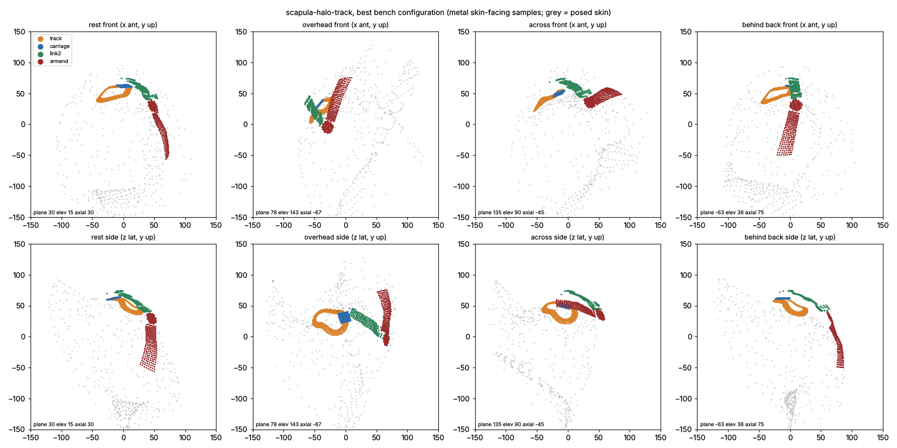

# Scapula halo track

The base is a closed, non-circular track fixed to the scapula handler. It is drawn on the skin that moves least
against the scapula, around the acromion summit. J1 is a bogie carriage on that track: its position s along the track
is the joint value. J2 is an O20 hub on the carriage, with its axis radial through GH. Link 2 is a strap of arc a2 to
J3, an O20 hub on the deltoid cap that is fixed to the arm. That makes 3 active DOF (s, q2, q3) and no free passive
coordinate.

## Deeper-version prompt (answered before modelling)

1. **What would a top mechanism designer do that the spec does not ask for?**
   - Treat the track as a cam surface, not a ring. Its radius from GH should follow the skin under it, so the track
     hugs the skin. The radial offset this creates at J2 is then taken up by a cam-set slide. That slide is set by s
     alone, so it is determined, not free.
   - Draw the track's plan shape from the closure itself (where the J2 crossings actually land), not only from the
     motion contour.
   - Check the transmission angle at the crossing, because a near-tangent crossing back-drives the carriage.
2. **Rawest material.**
   - The posed render skin of every bench pose: B.dist and the K3 requirement are marched on it, with no percentile
     summaries of radii.
   - The scapula-frame skin-motion grid in `pipeline/conformal/analysis/skin_motion_map_14.json` (the per-cell motion
     values, not the zone summary). The track's plan shape is drawn from it.
   - Every 10 fps frame of the fit clips, for continuity (the bench samples every ~6th frame).
3. **Methods and tools.**
   - Closure is a 1-D root search of angle(u(s), w) = a2 along the track polyline, refined on the interpolated curve.
   - The branch is set by the sign of t.w at the root (in or out of the circle about w).
   - Skin-fitted undersides use the sphere-traced K3 requirement, vectorised over samples.
   - Non-adjacent clearance is checked with KD-tree interval-overlap tests.
   - The sweep is coarse, then refined, over track threshold, shrink, W, a2, sigma and q, on Bench(60,160) with the
     fast grid cache.
4. **What shows the number is right, other than me.**
   - The common bench, which uses the same metric code as the 3R baseline (gap 68.93).
   - The adversarial verifier.
   - A red-team pose list: the jamming pose (where the crossing goes tangent), the pinch point (the smallest
     metal-to-skin distance over the taken poses), and behind-the-back and across-the-body extremes.

## Result on the bench (Bench(60, 160), fast grid cache, 126 configurations)

**Best: gap 87.64.** The 3R baseline scores 68.93, so this morphology is 19 points worse.

| reach | follow | inband14 | inband10 | contact | closure | mass |
|---|---|---|---|---|---|---|
| 0.531 | 0.783 | 0.559 | 0.341 | 0.000 | 64.5 % of poses | ~102 g Ti |

- **Configuration:** thr `ib100` (the bench in-band loop, shrink 0, closed); W = (delta 100, az -15); a2 75;
  sigma -1; q 1.0; stacking order A.
- **Shape:** track underside 51-65 mm from GH; J2 link eye at 74.7 mm; cam-set radial slide of 13.2 mm; J3 disc at
  71.9 mm; link 2 at 64-79 mm.
- **Reproduce:** `python3 docs/concepts/models/scapula-halo-track.py best`.
- **Data:** every configuration is listed in order in `sweeps/scapula-halo-track.json`, with the stage tag in
  "stage". Entries 0-16 come from earlier, buggy versions of the model and are kept for the record. Their bugs: the
  map-contour tracks, mean smoothing across the zone edge, link 2 clearing the carriage at a 60 mm radius instead of
  its own, and no clearance between link 2 and the neck. Entries 17-125 use the final model.

In band per member (2-14 mm, over the clip frames taken):

| track | carriage + J2 eye | link 2 | J3 disc + neck |
|---|---|---|---|
| 0.80 | 0.27 | **0.14** | 0.63 |

## What limits it (measured)

1. **Closure / reach.** The loop has to stay on skin where a scapula-fixed part can be in band in every pose. That
   zone is small: a polar cap above el ~65 deg, plus a posterior lobe at az -24..72 and el >= 30-45, at 45-64 mm from
   GH. Elsewhere on the scapula sphere, the arm or trunk covers the skin in some pose:
   - At elev 150-165 the requirement is 100-400 mm medially and posteromedially.
   - Laterally it is covered in elevation.

   A loop on this zone is about 153 deg of arc long. Its two-circle crossing exists in only 64.5 % of poses, and the
   bench's rest pose (plane 30, elev 30) is not among them. The 70 workspace poses with no crossing are mostly the
   axial-rotation extremes (axial >= 90 or <= -45) and behind-the-back.

   Growing the loop by 3 deg (shrink -3) raises closure to 70.5 %, but the track then has to sit at 116-166 mm
   (gap 160).
2. **Link 2 (14 % in band).** Link 2 is rigid and spans from the scapula zone to the arm. Its J2 end sits at the
   track's highest point plus the carriage (74.7 mm; the 13 mm cam slide adds to that). It must also clear the deltoid
   in every pose. Its median distance to the skin reaches 30 mm with the arm hanging in external rotation (red team:
   poses 74, 80, 81, 86, 107). This is the baseline's own link problem, moved one joint along.
3. **The arm-fixed J3 disc and neck (63 %).** No humerus-frame direction is in band in >= 90 % of the poses.
   - The best region is lateral: az -20..40, delta 90-100 (worst-pose requirement 63-67 mm, spread 9-13 mm).
   - At delta >= 110 the acromion covers the disc overhead.
   - A short link 2 would need J3 near the acromion, so it fights this.
4. **q < 1 does not help.** At q 0.97 the worst 3 % of poses become link 2 sweeping into the track (19 poses) rather
   than contact. In-band rises to 0.72, but reach drops to 0.37 (gap 92.4).

## Red team on the best configuration

- **Named poses.** Rest (ws, plane 30 elev 30), overhead (ws, elev 165) and across the body (ws, plane 75 elev 90)
  are all not taken, because there is no crossing. Behind the back (clip, plane -63 elev 36 axial 75) is taken: min
  4.3 mm, median 13.1 mm, in band 0.52. Hand to mouth is taken: min 4.8, median 14.6, in band 0.46.
- **Jamming pose.** Reach a high shelf (plane 80, elev 114, axial -80): |cos phi| = 0.203, meaning link 2 meets the
  track 78 deg from its tangent. That is close to the 10 deg singularity margin (0.17). An unpowered arm pushing there
  back-drives the carriage poorly (R17 risk).
- **Pinch point.** The carriage comes within 1.9 mm in workspace pose plane 45 elev 30, just inside the 2 mm band
  edge. The arm-end comes within 2.0 mm at elev 165, and within 2.03 mm at plane 105 elev 45 axial -165.
- **Bogie turn radius.** The loop's smallest in-plane turning radius is 8.7 mm at its radius, at the posteromedial
  corner. A 20 mm bogie with a 15 mm roller pitch cannot run it as drawn. The corner needs a larger radius, which
  shrinks the loop further.

## Verdict

**Not worth a GPU sweep as it stands.**
- The idea's central claim holds: the J2 locus, the track, can be put on skin where it is 80 % in band (the
  baseline's J2 pole zone is not).
- But two structural limits remain, and both are measured:
  - **Reach:** the in-band zone is too small for the two-circle closure to reach 90 %.
  - **Proximity:** link 2 is a rigid scapula-to-arm member, the same thing that limits every rigid 3R.

  Removing them needs one of two things: a different link 2 (one that hugs or slides) or a larger zone. A larger zone
  means a different base, for example a track fixed to the thorax with a scapula-tracking compliance. Either is a
  different morphology.

## Spec changes (stated, also in the model's docstring)

1. **Track radius.** The track's radius follows the skin, so the bogie needs a pitch pivot and the J2 pin a radial
   slide through link 2's eye. Both are set by s (cam-set), so they are passive and outside the active count, and
   nothing sags.
2. **Plan shape.** The plan shape comes from a bench in-band map, the K3 requirement in every pose. The spec used the
   skin-motion contour. That contour runs over skin the raised arm covers: the requirement there is 100-400 mm.
3. **Branch.** The branch is picked by the sign of t.w at the root. The spec's sign((u x du/ds).w) cannot tell the
   two crossings of a convex loop apart.
4. **Transversality.** Transversality is checked as |cos phi| >= sin 10 deg.
5. **Continuity.** Continuity is checked on every 10 fps frame of each fit clip.

## Audit (adversarial re-check, 2026-10-15)

Verdict: **the death stands.** I re-measured the best config on Bench(60,160) (fast cache) and got the same numbers: gap 87.64, reach 0.531, follow 0.783, in-band 2-14 0.559, in-band 2-10 0.341, contact 0. Most of the gap is closure (78 of 220 poses have no crossing). Link 2 in band 0.14 is the second limit.

Checked against `tools/concept_baseline.py`:
- **Conventions.** The bench, sample density (2 mm grid), O20 hub size and stack all match. The model is stricter than the baseline in three ways: clip continuity, the non-adjacent clearance check, and q=1 instead of the baseline's p95 profile with 10 % contact. All three are required by the honesty rules, so they are not over-strict. q 0.97/0.99 was swept and is worse (92-95).
- **A real bug, but it does not move the number.** `ib_map` turns a direction with no requirement found (inf) into 400 mm. A direction at 400 in every pose then counts as "in band" (max - req = 0). About 110 such cells, all at low el. The contour only grows down from the pole and erodes, so the cells never reach the loop. They do not affect the result.
- **Was the parameter range too narrow?** This was the real candidate. The loop (el 44.6-79.6) is much smaller than the true in-band zone: share 1.0 and top < 150 mm, which reaches el ~10-30 on the posterior side (az -36..72). An upper bound with J2 allowed anywhere in that zone (W_delta 75-120, W_az -60..90, a2 40-140, 1.5 deg margin, no transversality / clearance) gives reach 0.79 / clip 1.0 for el >= 30. The bound falls to 0.67 / 0.92 for el >= 60. The ib100 loop itself is bounded at 0.54-0.59 / 0.83-0.85. So the eroded, max-smoothed contour does cost closure.
- **Re-measure with a loop drawn on the full zone.** Same Track fit, contour eroded only 1 or 2 az cells, 5-tap mean with no max-smoothing, top < 150 filter. I ran 8 configs (W (100,-15)/(85,-10)/(80,-10)/(90,-15), a2 75-85):
  - eroded 1 cell: closure 0.71-0.73, but the 3-harmonic loop leaves the zone. Track 97-149 mm, link 2 and carriage 0 % in band, gap 121-148.
  - eroded 2 cells: track 51-74 mm, but closure 0.63-0.67, link 2 1-3 % in band, and link2/armend interference in up to 22 poses. Gap 111-119.
  - Every config was worse than 87.64.

Measured reason, in one line: no smooth loop that stays inside the scapula in-band zone closes more than ~67 % of poses, and widening it either puts the track 100-150 mm out or pushes the rigid link 2 out of band.

Audit script: `/tmp/claude-0/-home-user-exo-shoulder/029f38fb-570e-5d7a-bebc-fc64e6215529/scratchpad/halo_audit4.py` (not committed).
