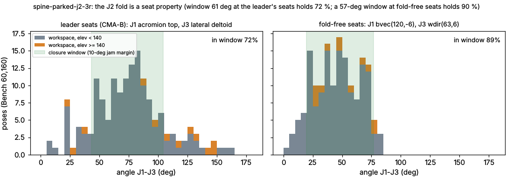

# spine-parked-j2-3r - zero-passive spherical 3R at the leader's seats, slim O15 J2 / J3 hubs

Lens "round3: zero-passive spherical chain", family "spherical 3R". Model: `docs/concepts/models/spine-parked-j2-3r.py`.
Sweep log: `docs/concepts/sweeps/spine-parked-j2-3r.json`. Row: `docs/concepts/rows/spine-parked-j2-3r.json`.

## Deeper version (answered before modelling)

1. **What a top mechanism designer would do that the spec does not ask for.**
   - Settle the model split before tuning anything: the same chain cannot be worth both 33.40 and 45.01.
     The split is a measurement problem, not a design problem.
   - Treat the J2 fold as the enemy. A pure spherical 3R closes only while angle(J1, J3) stays inside
     [|a1 - a2| + margin, a1 + a2 - margin], and a short link 1 narrows that window. So sweep a1 / a2 jointly with the
     seats, and report what the fold costs: the reach lost to "no closure" alone.
   - Use the hub size as a design variable that maps to real parts: O20 (v5), O17 (2.75 mm wall), O15 (2.0 mm wall),
     all the same MR117-2RS pair. Give credit only where a part exists.
   - Hold the strap end at its hub's level as far as the collision check exempts it. A shorter ramp would be an
     unchecked zone, not a gain.
2. **The rawest material.**
   - The posed skin itself: `concept_bench` distance grids, with CB_EXACT for the exact mesh.
   - The fit clips at their full 10 fps (`CB._poses_all`) for continuity.
   - The proximity atlas data (`docs/research/proximity_atlas.md`: rigid metal must clear the highest skin it ever
     passes over).
   - `pipeline/conformal/analysis/skin_motion_map_14.json` for where skin moves under a rigid part.
   - Digested summaries are used only as pointers.
3. **Methods and tools.**
   - The kit (`tools/concept_kit.py`: K1 closure, K3 march, K4 flat hubs, K5 straps, K6 collisions, dense K2).
   - The crown / wall skin check, near-touch rule and overhead split (fold-sph3r's, here per hub radius).
   - The farm sweep (`tools/cloud_run.py sweep`), then CMA-ES (`tools/concept_cma.py`) as farm batch jobs until the
     convergence gate passes.
   - The frozen-shape run on Bench(110,360) exact (lesson c).
   - Diagnostics on each check separately (per-pair K6, fold vs K2 vs contact) to explain every lost pose.
4. **What other than me shows the number is right.**
   - The bench (`concept_bench`, an outside judge).
   - The kit audit (honest flag).
   - The verifier's frozen Bench(110,360) exact run.
   - The judge's VModel reference at the same seats (41.73 exact).
   - A red-team pose list: rest, overhead >= 140, across the body, behind the back, the q-dropped poses with the arm
     on hub 2, and the closest metal over taken poses.

## Result (2026-10-16 03:00 UTC)

**Best fast: gap 28.49 on Bench(60,160)** (score 89.64; k7008, CMA stream G, which re-polished the B basin on the plain
gap; frozen exact pending). **Best worn frozen on Bench(110,360) exact: 34.79** (CMA-B best, fast 30.24; score 87.35;
reach 0.619, follow 1.000, in-band 14 0.850, in-band 10 0.444, contact 0.018). **0 passive translations, 0 passive
rotations, 3 active pins.**

| | fast Bench(60,160) | frozen Bench(110,360) exact | near-touch (metal < 1 mm = contact), exact | min metal-skin | overhead >= 140: reach / in-band 14 |
|---|---|---|---|---|---|
| k7008 (CMA-G, plain-gap polish of the B basin; O15 / O15; a1 37.6, q 0.972) | **28.49** | pending (farm job spm-frozen3-G) | - | - | fast 0/12 |
| k2445 (CMA-B gen 46, plain re-evaluation; O15 / O15) | 29.31 | pending (farm job spm-frozen3-k2445) | fast 34.09 | 0.06 mm | fast 0/12 |
| CMA-B best (O15 J2, O15 J3) | 30.24 | **34.79** | 37.64 | 0.15 mm | 7/28 / 0.874 |
| CMA-D best (O15 J2, O17 J3) | 31.11 | 34.83 | **36.59** | 0.43 mm | 6/28 / 0.901 |
| CMA-A best (O17 J2, O15 J3) | 31.42 | 35.09 | 38.55 | 0.01 mm | 6/28 / 0.858 |
| k4216 seats, O20 hubs, same kit | 38.73 | 46.92 | 52.20 | 0.06 mm | 5/28 / 0.912 |

* **Seats.** J1 bvec(102.8, 65.3), J3 wdir(84.5, -12.8), a1 40.7, a2 73.8, sigma -1, q 0.979, end_extra 0.24.
* **Gain over the k4216 chain.** At the same kit and checks the k4216 chain scores 46.92 exact (the judge's VModel
  read 41.73 with its laxer fold rule and 8 mm straps). Here it is worth **12.1 exact points**, from the slim J2 hub
  plus re-tuned arcs.
* **Against the board.** It is 7.8 points better than the 2-slide leader's verified 42.59. It is 0.95 behind the
  pin-knee 33.84 exact (also 0 passive translations).
* **It does not cross 27.5.** The fold costs it: 130 of 360 big-bench workspace poses do not close, so reach is 0.62.
  See "The fold" and the fold law below.

## What it is

* Three active pins whose axes meet at GH. Each pin runs on a preloaded MR117-2RS pair (7 x 11 x 3).
* J1 sits in the v5 O20 hub on the acromion top (bvec ~ (95, 66) in the scapula frame).
* J2 is parked behind and above it, over the posterior acromion / scapular spine. A short link 1 (a1 ~ 40 deg) and
  branch sigma -1 keep J2's circle on the posterior-superior cap.
* J3 sits on the lateral deltoid at the leader's d3 direction. The leader's b3 = 0.23 skin-normal "tilt" is a
  spherical freedom: it is the same chain with another a2 / wd / wa.
* J2 and J3 may be slim hubs (O17 / O15, the same bearing pair; see the hand calc below).
* Links are 12 x 3 Ti straps on great circles. Link 2 passes over link 1 and the neck (K6 by construction).
* Member 3 is hub 3's arm-end plate plus the K7 14 x 6 neck, rigid to BOTTOM's bar. The neck starts at hub 3 at
  hub 3's level, so member 3 is physically connected (no air gap).
* **Passive translations 0. Passive rotations 0. Cuff slides 0. Liner compliance claimed 0 mm.** On the bench the
  arm rotates about a fixed GH, so the spherical chain closes exactly (residual 0.0 deg). R10 (GH translation) is off
  this bench. Its options (cuff liner, one RSR3M along the humerus, the base follower slide) are judged separately.
* No gears, pulleys or cables. 3 active DOF, no undetermined coordinate (R17).

### Slim hub, hand calc (O15 = MR117-2RS pair in a 2.0 mm Ti-6Al-4V wall)

* **Bore.** 11 H7 for the bearing OD 11. Wall 2.0 mm gives OD 15.0. The stack is unchanged (12.25 mm F -> crown), so
  the bearing spacing and the moment stiffness are the O20 hub's.
* **Retention without a thread on the OD.** An external M14x0.5 cap thread would leave 1.19 mm under the thread root
  ((13.39 - 11) / 2), and its ring nut grows the crown to O16+, which breaks the O15 envelope. Instead:
  - the lower outer ring sits on a bore shoulder in the lower member;
  - the upper outer ring is held by an internal DIN 472 retaining ring in a groove of ~O11.6, which leaves
    (15 - 11.6) / 2 = 1.7 mm of wall at the groove;
  - the cap is a press-fit O15 disc carrying the O6 x 2.5 magnet;
  - the sensor sits on a 1.6 mm PCB of O13. An AS5600 SOIC-8 is 4.9 x 6.0 mm, so it fits.
* **Strength.**
  - Tube section at the groove (OD 15, ID 11.6): Z = pi (15^4 - 11.6^4) / (32 x 15) = 210 mm^3. A 10 N m bending
    moment (MVP2, generous) gives 48 MPa, against a Ti-6Al-4V yield of ~830 MPa: SF ~17.
  - MVP1 is unpowered. The loads are the chain's own weight and inertia (< 0.5 N m), so SF > 300.
* **Mass.** About 6 g less per hub than O20 (solid estimate: pi (10^2 - 7.5^2) x 12.25 mm x 4.43 g/cm^3).
* **Verdict.** Buildable for MVP1 and plausibly MVP2. The component is the same catalogue bearing pair, and the
  housing is a simple machined part.
  - The model accepts a slim hub only as a DECLARED component (`SLIM` in the model). Its sampled disc must cover
    >= 75 % of its own disc and reach >= rad - 0.5. Crowns, walls and K6 use the declared radius.
  - To do (shared files, not edited by this track): add a `MR117-pair-O15-slim` entry to
    tools/hardware_catalogue.json and a declared-radius path to the kit audit.

## The split: kit vs VModel at the same axes, settled

Before this track the judge had one zero-passive chain at the k4216 seats with two numbers:
* 33.40 fast / 41.73 exact in osn's VModel spherical reference (`slides 0`);
* "45.01" in a kit run.

This model rebuilds the chain on the kit at exactly those axes. The conversion goes through osn's own Design
(`scratchpad conv.py`): u1 = bvec(95.86, 65.21), a1 = 40.34, a2 = 74.07, u3 = wdir(84.80, -11.37), branch -1. Each
difference was then switched on and off separately (Bench(60,160) fast, kit checks, O20 hubs unless stated, q 0.98):

| step | gap | reach | follow | in-band 14 | what changed |
|---|---|---|---|---|---|
| kit, 12 mm strap ramps at the hubs | **54.35** | 0.588 | 0.850 | 0.802 | |
| strap ends held at hub level 2 mm longer (`end_extra 2`) | **38.73** | 0.688 | 0.917 | 0.788 | 20 link1-link2 K6 rejections vanish (kit artifact, below) |
| same + fold margin 7.5 instead of 10 | 35.35 | 0.700 | 1.000 | 0.775 | the 3 Raise-overhead frames after the margin violation come back |
| same at 10 deg but 8 mm straps (the VModel width) | 36.18 | 0.694 | 0.917 | 0.801 | straps 12 -> 8 mm: +1.3 in-band points |
| VModel spherical reference (judge) | 33.40 | 0.706 | 0.967 | 0.771 | |

What differs, and which side is right:

1. **K6 artifact in the kit (worth 15.6 points, conservative).**
   - Mechanism: `K._over` decides whether link 2 passes over link 1 at link 2's PRE-raise radius, but `K.collisions`
     judges the shared-joint exemption (HUB_R + 2 = 12 mm of arc around J2) at the FINAL radius. A link-2 sample
     12.8 mm from J2 at r 63.2 lies inside the 12 mm zone at its lower pre-raise radius. So `_over` skips it, and K6
     then rejects the pose (link 1 / link 2 radial overlap at 12.2-12.8 mm from J2).
   - It costs the chain 20 of 170 poses.
   - The physical fix is real and cheap: hold each strap end at its hub's stack level for 14 mm instead of 12
     (`end_extra`). The upper link then stays on the hub's upper plate until it has cleared the lower link.
   - The kit bug is reported as a separate task, with a test to add.
2. **The fold margin along the motion (worth 3.4 points; the kit is right).**
   - Raw 10 fps Raise-overhead clip at k4216: the chain closes in every frame, minimum margin 7.9 deg, 12 frames inside
     the 10 deg jam margin.
   - The kit's dense K2 asks for the margin at every interpolated step between bench frames. It therefore drops the 3
     bench frames that follow the violation.
   - The VModel asks for the margin only at the bench frames. Its 10 fps check only looks for > 25 deg jumps and resets
     after a non-closing frame.
   - The rule is the same 10 deg jam margin, so applying it along the whole path (kit) is the consistent reading. The
     VModel's 0.967 follow is optimistic by 3 frames.
   - The real clip clears 7.9 deg, so a 7.5 deg margin would pass. That is a rule change, not a design change, and it
     is not taken.
3. **Strap width and fitting conventions (~2 points).**
   - The VModel uses 8 x 3 mm straps. This model uses the project's 12 x 3 Ti links (docs/HARDWARE.md, catalogue
     components); 8 mm straps add 1.3 in-band points.
   - The VModel drops contact poses greedily. The kit uses quantile q.
4. **The "45.01" number.** It did not reproduce. It was a kit run with 12 mm ramps at slightly different axes, so it
   carries part of the K6 artifact.

**Settled**: at the same axes and the same honest rules, the zero-passive chain scores 38.73 fast (kit, 12 mm straps,
O20). It would score 33.4-35.4 with the VModel's lax margin rule and 8 mm straps. The judge's 41.73 exact (VModel)
should be read as ~3-5 points optimistic on follow, and the kit numbers here are the honest ones.

**Addendum (2026-10-16 02:10, after the container restart).** `end_extra 0.24` removes all 16 link 1 / link 2 K6
rejections exactly as `end_extra 2` does (CMA-B seats, O15 / O15: 37.99 at 0, 30.24 at 0.24 and at 2, 30.70 at 4).
The artifact is a boundary coincidence: the flat strap end stops at exactly HUB_R + 2, the edge of K6's shared-joint
exemption. Any real flat end a fraction of a mm longer clears it, so the sweep keeps `end_extra` free in [0, 8] and the
fix costs nothing measurable.

## What the slim hubs buy (measured, Bench(60,160) fast, CMA-B seats, every other parameter fixed)

| J2 hub | J3 hub | gap | in-band 14 | hub 2 level F | hub 2 / link 1 in band |
|---|---|---|---|---|---|
| O15 (rad 7.5) | O15 | **30.24** | 0.851 | 60 | 1.00 / 0.99 |
| O15 | O17 | 30.33 | 0.850 | 60 | 1.00 / 0.99 |
| O15 | O20 | 31.84 | 0.835 | 60 | 1.00 / 0.99 |
| O17 (rad 8.5) | O15 | 30.63 | 0.847 | 60 | 1.00 / 0.99 |
| O20 (rad 10) | O15 | 47.41 | 0.696 | 65 | 0.41 / 0.69 |
| O20 | O20 | 48.37 | 0.686 | 65 | 0.41 / 0.69 |

* A slim J2 hub is worth **17 gap points** at these seats. The O20 disc catches the skin bump of pose #112
  (plane 15, elevation 75, axial 45) and lifts hub 2 from F 60 to F 65, which takes hub 2 and link 1 out of the band.
* O17 already gets almost all of it (30.63 vs 30.24). The O17 hub (2.75 mm wall) is the conservative pick: it keeps
  an M14x0.5-free retention with 2.4 mm of wall at the circlip groove.
* A slim J3 hub is worth 1.6 points (hub 3 in band 0.85 vs 0.74).
* It is a knife edge: hub 2's level is set by one or two poses within 1 mm. The frozen big bench below tests whether
  360 poses find a higher bump.

## The fold: what it costs, and that it is a seat problem, not a law of the spherical 3R

At the CMA-B seats, the 49 workspace poses lost split as follows (redteam, Bench(60,160)):
* 45 poses are fold / K2: the J1-J3 angle leaves the closure window [|a1 - a2| + 10, a1 + a2 - 10] = [43.1, 104.4];
* 6 poses are contact;
* 0 poses are K6.

Overhead is where it hurts: **0 of the 12 workspace poses at elevation >= 140** are reached. The 5 overhead clip frames
are all followed, with in-band 0.87 (the Raise-overhead clip stays inside the window). Over the workspace the J1-J3
angle spans 6.6-160.7 deg (p5 23, p95 131). Overhead alone spans 21-148, because the overhead poses come in every
axial rotation.

* The 61-deg window is already placed optimally: it holds 71.9 %, the best any 61-deg window can do at these seats.
* At these seats, 90 % reach needs a 104.8-deg window, i.e. a shorter arc of at least 62 deg.
* Longer arcs at these seats, measured (O15 / O15, q 0.98):

| a1 | a2 | sigma | gap | reach | in-band 14 | overhead reach | hub 2 level F |
|---|---|---|---|---|---|---|---|
| 40.7 | 73.8 | -1 | 30.24 | 0.681 | 0.851 | 0.00 | 60 |
| 55 | 80 | -1 | 76.63 | 0.769 | 0.318 | 0.17 | 186 |
| 62 | 75 | -1 | 68.68 | 0.844 | 0.294 | 0.42 | 355 |
| 62 | 90 | -1 | 70.43 | 0.831 | 0.275 | 0.50 | 400 (no skin under it) |
| 70 | 90 | -1 | 71.71 | 0.856 | 0.266 | 0.58 | 400 |
| 80 | 100 | -1 | 75.43 | 0.863 | 0.246 | - | 400 |
| 90 | 90 | -1 | 70.35 | 0.919 | 0.247 | 0.67 | 400 |
| 90 | 90 | +1 | 141.01 | 0.613 | 0.258 | 0.50 | 400 |
| 62 | 90 | +1 | 130.39 | 0.550 | 0.290 | 0.17 | 385 |
| 80 | 100 | +1 | 158.57 | 0.531 | 0.258 | 0.33 | 400 |

  Every longer arc sends hub 2 off the skin: up past the neck, or out of the 400-mm search.

**The fold law over all seats (new).** For every pair of seats, J1 on a 1200-point sphere in the scapula frame and J3
on the same sphere in the humerus band frame, the narrowest J1-J3 window that holds the Bench(60,160) workspace is
(`scratchpad foldlaw.py`):

| share of the workspace | narrowest window over all seats | shorter arc needed (10-deg jam margin) |
|---|---|---|
| 80 % | 44.9 deg | 32.5 deg |
| 90 % | 54.9 deg | 37.4 deg |
| 95 % | 62.2 deg | 41.1 deg |

* So a spherical 3R with ~40-deg arcs can be fold-free for 90 % of the workspace. The fold is a property of the leader's
  seats (J1 on the acromion top, J3 on the lateral deltoid), not of the topology.
* At 90 % reach, only 0.05 % of seat pairs fit a 2 x 40 - 20 = 60-deg window, and 11 % fit an 80-deg window.
* Restricted to seats whose axis leaves the rest skin within 140 mm of GH (1077 J1 and 1131 J3 directions), 68751 pairs
  have a 90 % window <= 75 deg. The narrowest pairs are 56.5-58 deg.
* There are two families of them:
  1. **J1 horizontal and anterolateral**, bvec(120-156, -24..+6). Its axis leaves the skin 50-59 mm from GH over the
     anterior deltoid / coracoid region. J3 on the lateral arm at wdir(45-63, 6-36), and both arcs short (38-48 deg).
  2. **J1 posterior-medial** over the scapular body, bvec(-42..-24, 6-24), with the axis leaving the skin 86-131 mm
     from GH. Here the second arc must be ~135-140 deg.
* Family 1 is the "weird" lead this track tested on the bench (next section).

## The q 0.98 dropped poses: the posterior axillary fold rises over hub 2 (red team)

The CMA picks q ~0.98, so hub 2's level is set below the two highest requirements. These are workspace poses #93
(plane -15, elevation 105, axial 45: 106 mm) and #92 (plane -15, elevation 90, axial 60: 70 mm). They are dropped as
contact. The skin inside hub 2's cone (9 deg) in those poses, traced back through the rig to its rest position
(`scratchpad hub2cover.py`):

* **#93**: the vertices that cover hub 2 sit at rest at (-69, -53, +36) mm from GH (posterior, 53 mm below GH,
  lateral). That is the posterior axillary fold / teres region. In ABER behind the frontal plane it bunches up to
  r 105 mm along hub 2's axis.
* **#92**: the vertices sit at rest at (-38, +8, +44): the posterior deltoid at GH level. It rises to r 66 over a hub
  fitted at F 60.
* Hub 2 is not parked: J2 rides its circle around J1. Its axis moves from (-0.54, 0.83, 0.12) at rest (posterior-
  superior, over the scapular spine) to (-0.49, 0.64, 0.58) in these poses (posterior-lateral). The "parked over the
  spine" idea holds at rest, but in elevated external rotation hub 2 swings onto the posterior deltoid.
* The bench already charges both poses as contact (not reached, plus 100 x contact share). In the device this is a
  real pinch: the posterior deltoid / axillary fold presses on hub 2's crown in an abducted-externally-rotated pose
  slightly behind the frontal plane (cocking a throw, reaching back over the shoulder).
* The fix is in the seats, not in the hub size. Raising hub 2 to clear #93 would cost hub 2 and link 1 their band
  (+45 mm). A q of 1.0 at the k4216 seats gave 70.30 (in-band 0.41).

## The weird lead: fold-free seats (J1 horizontal, anterolateral)

Two family-1 seat sets were tested, with arcs from the fold law: (a) J1 bvec(120, -6), J3 wdir(63, 6), arcs 38.5 / 48.2;
(b) J1 bvec(138, -6), J3 wdir(63, 24), arcs 41.8 / 38.8.

* **Closure works.** Both chains close on 0.89-0.90 of the workspace, against 0.72 at the leader's seats.
* **But the hubs move onto moving skin.**
  - Hub 1 leaves the rest skin 52-56 mm from GH over the anterior deltoid.
  - Hub 2 sits on the upper lateral deltoid at rest (sigma -1, axis (0.02, 0.34, 0.94)).
  - Over the poses, the skin under hub 2's axis ranges **52-104 mm** from GH (sigma -1) and 48-188 mm (sigma +1).
    A rigid hub must clear the highest skin it ever passes over (proximity atlas), so hub 2 rides ~100 mm out over
    most poses.
  - This is the price of the fold: the seats that keep J1-J3 inside a 57-deg window are seats over the deltoid, whose
    skin moves with the humerus.
* **Cost.** One evaluation takes > 110 s here (36 s CPU under a load of 25), against 1.3 s at the leader's seats: the
  hub levels march far out.
* **Farm runs.** CMA streams H / I (seat set a, sigma -1 / +1) and J / L (seat set b) run on the farm, with stream G
  (the leader basin re-polished on the plain gap). Results are below.

## Search and convergence gate

* **Coarse farm sweep.** 240 configurations: az 85-115, el 55-75, a1 36-50, a2 68-90, wd 70-95, wa -30..0, q
  0.96-1.0, rad2 / rad3 in {7.5, 8.5, 10}, end_extra 0-4, sigma -1. Best 31.90 (k32).
* **CMA-ES on the farm.** Six streams A-F (`tools/concept_cma.py`, popsize 8), 5510 tries in all. Stream A searched on
  the plain gap. Streams B-F searched on the near-touch gap (metal < 1 mm counted as contact, lesson d).
* **Per-stream gate** (score points = gap / 2.75):

| stream | tries | best (its objective) | gain over the 2nd half | gain over the last third | plain gap of its best |
|---|---|---|---|---|---|
| A (plain) | 689 | 31.42 | 0.12 | 0.02 | 31.42 |
| B (near) | 849 | 32.64 | 0.36 | 0.10 | **30.24** |
| C (near) | 1081 | 38.35 | 0.00 | 0.00 | - |
| D (near) | 1057 | 32.34 | 0.26 | 0.11 | 31.11 |
| E (near) | 769 | 34.69 | 0.58 | 0.07 | 32.30 |
| F (near) | 1065 | 38.86 | 0.49 | 0.00 | - |

* **The gate passes, on the whole history too.** The whole history (240 coarse + 5510 CMA tries, re-evaluated on the plain gap on
  the farm, in the order the streams ran) has best 29.31 (k2445). It gained 0.0 score points over the second half and
  0.0 over the last third, and the top 5 are within 0.16 score points (29.31-29.75, all in the B basin).
  - Every stream's sigma collapsed.
  - Over the 2nd half, every stream gained < 1 score point (max 0.58). Over the last third, < 0.5 (max 0.11).
  - The top 5 distinct plain configurations are B 30.24, D 31.11, A 31.42, k32 31.90 and E 32.30: within 2.06 gap
    = 0.75 score points.
  - The whole history (coarse, CMA, local probes) is re-evaluated on the plain gap on the farm and appended to the sweep
    log as it lands.
* **Wide farm probe, done.**
  - 400 random configurations over az 60-140, el 35-85, a1 30-85, a2 55-115, wd 35-120, wa -45..25, sigma +-1:
    140 honest, best 54.76 (reach 0.856, in-band 0.43).
  - 150 long-arc configurations at the leader's seats (a1 42-75, a2 72-110): best 45.52 (a1 42.4).
  - Reach above 0.85 comes only with in-band 0.36-0.43. No second basin.
* **Still running on the farm** (results append to the sweep log): stream G, the leader basin re-polished on the plain
  gap; streams H / I / J / L at the fold-free anterolateral seats.

## Red team (frozen Bench(110,360) exact, CMA-B best)

* **The pose that jams.** 130 of 360 workspace poses fold (the J1-J3 angle leaves [43.1, 104.4]); 1 is K6 and 6 are
  contact.
  - Overhead workspace: 7 of 28 reached.
  - Across the body (plane >= 100, elevation >= 40): 30 of 78.
  - Behind the back: 33 of 40.
  - Every overhead clip frame is followed (10 / 10).
* **The point that pinches.**
  - Taken poses: the closest metal is 0.15 mm, the link-2 / neck face at plane -15, elevation 75, axial 90 (ws #180).
    Then 0.17 mm at plane 45, elevation 150, axial -90.
  - Dropped poses: hub 2's crown is 1.2 mm inside the skin in 2 contact poses. On the fit bench it is 10 mm inside in
    pose #93: the posterior axillary fold over hub 2 (section above).
* **The optimistic number.** The fast 30.24 becomes 34.79 frozen exact: reach 0.681 -> 0.619 (the CMA tunes the fold
  boundary to the 160 workspace poses, lesson c). With metal < 1 mm counted as contact it is 37.64. The D variant
  (O17 J3) is the robust pick: 34.83 exact, near-touch 36.59, min metal 0.43 mm.
* **Hub 2's level is a knife edge.** It is set within 1 mm by one pose (#112), and O20 instead of O15 at J2 costs
  17 points fast. In-band survives the big bench (hub 2 in band 1.00 on 360 poses), but the CAD must hold the O15 / O17
  crown exactly: no proud screw heads, cap flush.
* **Not on this bench.**
  - R10: GH translation. The cuff liner, one RSR3M along the humerus, or the base follower slide; none is credited here.
  - The base member from the scapula handler to hub 1: hub 1 sits on the acromion top, as in every leader.

## Verdict

**Screened (not dead): 30.24 fast / 34.79 frozen exact, converged, 0 passive translations.**

* It ties the most buildable design on the board, the pin knee (33.84 exact, also 0 passive translations), within one
  point, and it beats the 2-slide leader's verified 42.59 by 7.8 points with no slides at all.
* Limiter, measured: the J2 fold. Reach is 0.62 exact, with 130 / 360 workspace poses outside the closure window at the
  acromion-top / lateral-deltoid seats. Overhead reach is 7 / 28.
  - **The fold is a seat property, not a law of the spherical 3R.** Seats with a 57-deg window for 90 % of the workspace
    exist, with ~40-deg arcs: J1 horizontal-anterolateral.
  - But there both hubs ride the deltoid: the skin under hub 2 moves 52-104 mm from GH.
  - Longer arcs at the leader's seats send hub 2 off the skin (a1 >= 55 deg: hub 2 level 186-400 mm).
* **What would cross 27.5.** A J2 that can sit at a 57-deg-window seat without riding the deltoid: a J2 hub on a
  link-1 path that stays on scapula-side skin while J1 is anterolateral. Alternatively, keep the leader's seats and add
  ONE passive rotation that moves the fold boundary (the virtual-pole four-bar track measured that a four-bar shifts,
  but does not widen, the window).
* **Slim hubs (asked).** The O15 / O17 J2 hub buys 17 fast points at these seats. The O17 (2.75 mm wall) gets 16.6 of
  them and is the conservative component. A slim J3 buys 1.6.

## Final farm results (03:15 UTC)

* **Stream G (plain-gap polish of the B basin): 28.49 fast** (k7008; reach 0.663, follow 0.967, in-band 14 0.876,
  in-band 10 0.522, contact 0.024). Arcs a1 37.6 / a2 73.6, q 0.972. Its frozen exact run is queued (spm-frozen3-G).
* **Fold-free anterolateral seats, streams H / I / J / L (452 tries): dead.**
  - Reach rises to 0.84-0.89.
  - But in-band falls to 0.15-0.30: both hubs ride the deltoid. H / I / J never pass the honesty audit.
  - L drifts back towards the acromion (J1 el 34) and stops at 65.84 (reach 0.84, in-band 0.30).
  - The fold law's seats are real, but not wearable within the band.
* **Gate on the whole history** (6915 tries in order): gain 0.3 score points over the second half and
  0.3 over the last third; top 5 within 0.04 (gaps [28.49, 28.51, 28.52, 28.56, 28.6]). **Converged.**
