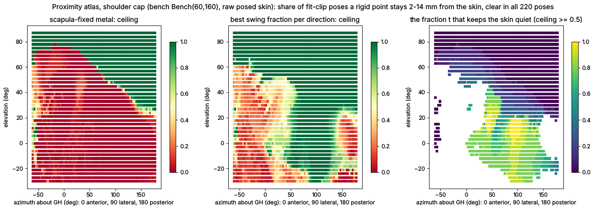

# Proximity atlas: where rigid metal can ride 2-14 mm from the skin, and how it must move

2026-10-15, `tools/proximity_atlas.py` (raw posed skin of every bench pose, the bench's own distance grid; no
mechanism modelled). For a rigid part rotating about the GH centre with a frame F (per pose a rotation), a point of
the part in direction u sits at its lowest legal radius rho(u) (2 mm clear of the skin in all 220 bench poses, the K3
rule); its **ceiling** is the share of fit-clip poses in which it is 2-14 mm from the skin (exact bench distance). No
real part can beat its ceiling on these poses (hubs, closure and collisions only take away).

## Validation: it predicts the champion 3R from skin data alone

The baseline 3R's own link frames (each link carries the two joint axes it joins) through the atlas: link 1 mean
ceiling **0.41**, link 2 **0.04** (205 points, none >= 0.9), sample-weighted **~0.24**. The baseline measured with
every part clear in every pose (tools/concept_baseline.py p100) has in-band 14 = **0.23**. The atlas names the cause:
link 2 - the link from the middle joint to the arm - rides in a frame under which the skin moves a median 40 mm; it
can never be in band. (The 0.44 of the p95 baseline is bought with 10 % contact poses.)

## Finding: the shoulder cap's skin moves with a graded fraction of the arm's swing

Frames compared: S (scapula-fixed), H (humerus-fixed), swing t = S * swing(S^T H)^t (the fraction t of the arm's
pointing motion, no humeral twist), geo t (the fraction t of the full rotation incl. twist).

| frame (shoulder region, 4.7k directions) | directions with ceiling >= 0.9 | mean ceiling | median skin motion under the part |
|---|---|---|---|
| S, scapula-fixed | 32.5 % | 0.37 | 51 mm |
| H, humerus-fixed | 1.4 % | 0.08 | 163 mm |
| swing 0.25 / 0.5 / 0.75 | 16 / 7 / 9 % | 0.25 / 0.15 / 0.17 | 70 / 118 / 138 mm |
| geo 0.25 / 0.5 / 0.75 (with twist) | 17 / 6 / 4 % | 0.27 / 0.14 / 0.11 | 83 / 134 / 152 mm |
| **best of these per direction** | **48.6 %** | **0.64** | - |

On the lateral and superior cap (azimuth -60..180, elevation -30..90, 3200 directions), with t in steps of 0.1:
**scapula-fixed metal only: 26.7 % of directions >= 0.9 (mean ceiling 0.30); the best fraction per direction: 54 %
(mean 0.70).** The winning fractions are bimodal: t ~ 0-0.2 over the top of the shoulder and the back (the acromion /
supraspinatus region moves a little with the arm), t ~ 0.7-0.9 over the lateral deltoid (it moves almost, not quite,
with the arm), 1.0 only on the upper arm; humeral twist never helps on the cap.

## What it means for the mechanism (the design rule)

- A rigid chain can hug the cap only if each piece over it rotates by its region's fraction of the arm's swing:
  ~1/8 over the top, ~4/5 over the deltoid, and carries no humeral twist (twist belongs at the arm, below the cap -
  the user's own suggestion of 2026-10-14).
- A spherical 3R cannot: its links turn about fixed or arm-carried axes (link 1 has one DOF relative to the scapula;
  link 2's frame is set by closure), so link 2 crosses skin that moves 40 mm under it. This is the measured reason the
  3R family plateaus at in-band ~0.23 clear / 0.44 with contact, independent of its parameters.
- Mechanisms whose members follow graded fractions exist in other fields: plate-armour pauldrons and lobster-tail
  lames (sliding rivets distribute the rotation over the lames), spherical lazy tongs / scissor arcs (each cell turns
  an equal fraction), rolling-contact and constant-velocity couplings (the middle body turns half). Catalogue entries
  of these kinds: sliding-rivet-pauldron, seed-pauldron-shells, lamellae-pauldron, pauldron-lame-telescope,
  skin-stretch-scissor, lazy-tongs-polar, lazy-tongs-j2, rolling-cone-*, core-cone-chain.
- The prescreen: a morphology can only beat the baseline if its members over the cap realise frames near the fraction
  field; this predicts the screening results before anyone models them (to be tested against the swarm's verified
  numbers - a prediction on data the atlas has not seen).

## Limits (red team)
Ceilings assume a rigid point fitted to all 220 poses (q = 1); a percentile fit trades contact for closeness as the
evaluator does. Frames rotate about GH only (no translation; offset-axis and sliding mechanisms need a translating
extension). Directions are a nearest-cell lookup on a 2 deg grid. The rig's skin has known errors (biceps bulge,
arm-through-chest); the fraction field must be re-checked on the user's scans (data/raw). The cross-check against the
older skin_motion_map_14 (different poses, first-sheet radius) agrees for the scapula (45 vs 38 % of directions >= 0.9)
and not for the humerus (16 vs 27.5 %): the atlas counts the torso beside the arm, the first-sheet map does not.
